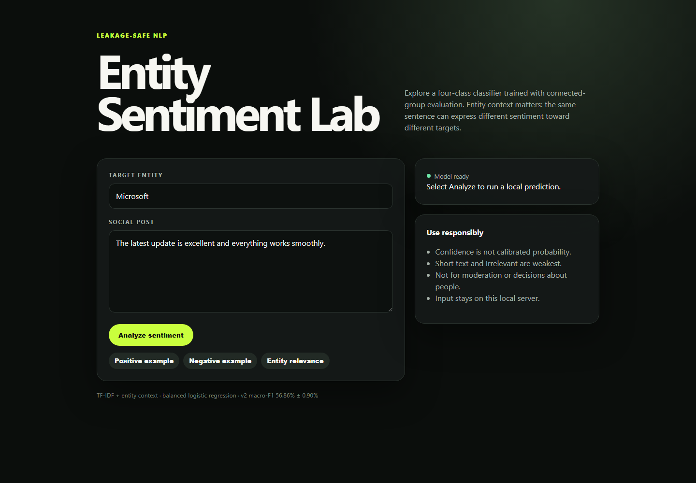

# SentimentAnalysis_NLP

[](https://github.com/kristishqau/SentimentAnalysis_NLP/actions/workflows/quality.yml)
[](https://www.python.org/)
[](LICENSE)

A production-minded, classical NLP baseline for four-class, entity-focused tweet sentiment. The project classifies text as **Negative**, **Neutral**, **Positive**, or **Irrelevant** while making data leakage, reproducibility, and artifact provenance first-class concerns.



The central result is not an inflated notebook score: it is a defensible evaluation protocol. Augmented variants in this dataset share tweet IDs, and text can recur under different IDs with exact or superficial formatting changes. This implementation keeps every connected duplicate family inside one fold during evaluation and model selection.

## Verified v2 result

The checked-in experiment evidence records:

- **58.11% ± 0.95% accuracy** and **56.86% ± 0.90% macro-F1** across five outer grouped folds.
- **2.68 macro-F1 points gained** by entity context over the word+character candidate.
- **0 shared tweet IDs, exact texts, or normalized near-duplicate texts** in every outer fold.
- Four comparable baselines, nested hyperparameter selection, fold-level metrics, runtime, artifact size, deterministic seed, input SHA-256, and package versions.

This score is intentionally lower than the original notebook's 84.9% random-split result. That older approach allowed related augmented samples to cross the boundary and selected models against its test set. See the [benchmark narrative](reports/BENCHMARK.md), [model card](reports/MODEL_CARD.md), and [machine-readable fold evidence](reports/benchmark_v2.json).

## Engineering highlights

- End-to-end scikit-learn pipeline: word `(1, 2)` and character `(3, 5)` TF-IDF, one-hot entity context, and balanced logistic regression.
- Leakage-safe connected grouping over tweet ID, exact-text hash, and conservatively normalized text.
- Nested grouped, stratified evaluation: five outer folds and three inner selection folds.
- Versioned model artifact containing preprocessing, classifier, and experiment metadata together.
- Installable `src/` package with train and predict CLIs.
- An enforced 85% branch-coverage floor, Ruff quality gates, Python 3.11–3.14 CI, dependency auditing, and Dependabot.

See the [architecture and engineering narrative](docs/ARCHITECTURE.md) for the system
boundaries, core design decisions, evidence trail, and an interview-ready walkthrough.

```text
headerless CSV
    │
    ├── schema validation + cleaning + SHA-256 provenance
    │
    └── connected duplicate groups (tweet ID ∪ exact text ∪ normalized text)
            │
            └── five outer grouped folds
                    ├── outer test fold → unbiased candidate score
                    └── outer training folds
                            └── inner grouped CV → model selection
                                    └── TF-IDF + entity → logistic regression
                                            ├── versioned model artifact
                                            └── reproducible metrics JSON
```

## Quick start

Requires Python 3.11 or newer.

```bash
git clone https://github.com/kristishqau/SentimentAnalysis_NLP.git
cd SentimentAnalysis_NLP
uv sync --locked --extra dev --extra notebook
```

This uses the checked-in `uv.lock` to reproduce the standard development and notebook environment without downloading the optional GPU stack. A conventional pip installation remains supported:

```bash
python -m venv .venv
# Activate .venv, then:
python -m pip install --upgrade pip
python -m pip install -e ".[dev,notebook]"
```

Train with the audited defaults:

```bash
uv run sentiment-train
```

The command writes a trusted local pipeline to `artifacts/sentiment_model.joblib` and complete evidence to `artifacts/metrics.json`. Training is CPU-intensive because it performs nine grouped-CV fits.

Predict one or more texts:

```bash
uv run sentiment-predict --model artifacts/sentiment_model.joblib --entity Microsoft "The update is excellent" "The service is frustrating and broken"
```

Reproduce the full published comparison and refit its winner:

```bash
uv run sentiment-benchmark --jobs 2
```

This audit path performs 150 nested fits and took about one hour of active wall time on the reference Windows laptop. Runtime is hardware-dependent; see the benchmark report's system-sleep timing caveat. Normal inference does not repeat the benchmark.

Generate group-isolated error slices for the selected architecture:

```bash
uv run sentiment-analyze --output reports/error_analysis.json
```

## Optional GPU benchmark

[](https://colab.research.google.com/github/kristishqau/SentimentAnalysis_NLP/blob/main/notebooks/transformer_benchmark_colab.ipynb)

The compact DistilBERT benchmark uses the identical connected outer folds and records
quality, training time, inference time, and artifact size. Its PyTorch stack is
isolated from the normal installation:

```bash
uv sync --locked --extra transformer
uv run sentiment-transformer-benchmark --folds 5 --epochs 1
```

For a free GPU, select the badge above, sign in to Colab, choose a GPU runtime, and run
the notebook cells in order. It starts with a two-fold smoke test before the full
five-fold evidence run and downloads the resulting JSON. Transformer results are
deliberately not claimed in this README until that GPU run completes and its evidence
is reviewed.

`joblib` can execute code during deserialization. Load only artifacts you created or obtained from a trusted source.

Launch the dependency-free interactive demo after training or benchmarking:

```bash
uv run sentiment-demo --model artifacts/sentiment_model.joblib
```

Open `http://127.0.0.1:8000`. The demo includes entity-aware examples,
uncalibrated confidence, responsible-use limitations, request-size validation, a
content-security policy, and a `/healthz` endpoint. It binds to localhost by default;
do not expose it publicly without authentication, TLS, rate limiting, and production
hardening.

For a reproducible container launch, first create the local model with
`uv run sentiment-train`, then run:

```bash
docker compose up --build
```

The image uses digest-pinned Python and uv bases, installs from `uv.lock`, runs as a
non-root user, and exposes a Docker health check. Compose binds only to localhost,
mounts the trusted model read-only, drops Linux capabilities, and uses a read-only
container filesystem. CI builds the image and verifies both health and inference.

## Explore and develop

- [Exploration notebook](notebooks/sentiment_analysis.ipynb) — compact EDA, leakage demonstration, split audit, and result visualization. It calls package code instead of duplicating training logic.
- [GPU benchmark notebook](notebooks/transformer_benchmark_colab.ipynb) — Colab workflow for the optional compact transformer comparison.
- [Data card](reports/DATA_CARD.md) — provenance, schema, quality findings, responsible-use notes, and licensing boundary.
- [Model card](reports/MODEL_CARD.md) — intended use, methodology, metrics, limitations, and ethical considerations.
- [V2 benchmark](reports/BENCHMARK.md) — candidate comparison, protocol, decision, and timing caveat.
- [Error analysis](reports/ERROR_ANALYSIS.md) — class, entity, length, frequency, confusion, and representative-error findings.

Run the same local gates as CI:

```bash
uv run ruff check src tests notebooks
uv run ruff format --check src tests notebooks
uv run pytest
uv run pip-audit
```

## Repository layout

```text
src/sentiment_analysis/   data, modeling, evaluation, artifacts, CLIs, and demo
tests/                    invariant-focused unit and integration tests
notebooks/                recruiter-friendly exploration and audit narrative
reports/                  model card, data card, and experiment evidence
docs/                     architecture narrative and verified demo media
data/                     source CSV files
.github/                  CI and automated dependency maintenance
```

## Scope and limitations

This is an educational portfolio project, not a moderation or decision-making system. The data contains offensive language, platform-specific entities, mislabeled or ambiguous examples, duplicated augmentations, and historical social-media language. Performance—especially for **Irrelevant**—is not adequate for high-impact use. Do not infer emotions, intent, identity, mental state, or personal traits from predictions.

The MIT license covers project code and documentation. The source dataset is published as CC0/Public Domain; see the [dataset provenance, hashes, and rights boundary](data/README.md). Privacy, platform, and third-party-content obligations still require separate consideration.

## License

Code and documentation are available under the [MIT License](LICENSE). Dataset licensing is separate as noted above.
