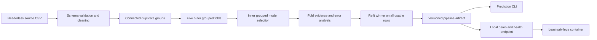

# Architecture and engineering narrative

## System shape

The repository deliberately separates **evaluation**, where model quality is measured,
from **inference**, where the selected pipeline serves predictions. This prevents a
demo-oriented shortcut from becoming part of the scientific evidence.

The installed package owns all data, modeling, evaluation, artifact, analysis, CLI,
and demo behavior. Notebooks call that package; they are explanatory interfaces, not
a second implementation.

## The important design decision: group before splitting

The source contains augmented samples that can share tweet IDs and text variants. A
row-random split lets a model see one version during training and a related version
during testing, producing an optimistic score.

The data layer constructs connected components over three relationships: shared tweet
ID, shared exact-text hash, and shared conservatively normalized text. A component is
indivisible during every outer and inner split. Checked-in fold evidence confirms zero
ID, exact-text, and normalized-text overlap in all five outer folds.

This is stronger than deleting duplicates: it preserves useful examples while making
their dependency explicit in the evaluation unit.

## Model boundary

The lightweight deployment model is one scikit-learn pipeline containing:

- word TF-IDF for phrases;
- character TF-IDF for spelling variation and noisy social text;
- one-hot target-entity context;
- class-balanced multiclass logistic regression.

Keeping transforms and the classifier together prevents training-serving skew. The
persisted wrapper also carries a schema version and experiment metadata. Because
`joblib` deserialization can execute code, only locally produced or otherwise trusted
artifacts may be loaded.

## Why this model won

Four candidates were evaluated on identical connected groups. The majority baseline
reached 0.1164 macro-F1; word TF-IDF reached 0.5333; word plus character TF-IDF reached
0.5418; adding entity context reached **0.5686 ± 0.0090** with **0.5811 ± 0.0095**
accuracy. Entity context therefore added 2.68 macro-F1 points on the same folds and won
all five fold comparisons.

The gain is meaningful because the task is entity-focused: sentiment in one message
can differ by target. The score is still modest. `Irrelevant` is the weakest class at
0.4689 mean F1, and short text remains a difficult slice. Those limitations are
reported directly because random row splits can overstate performance when augmented
families cross the evaluation boundary.

The subsequent identical-fold GPU benchmark established Twitter-RoBERTa as the quality
winner at **0.6355 ± 0.0140 macro-F1** and **0.6485 ± 0.0157 accuracy**. It improved
all four classes, including `Irrelevant` from 0.4689 to 0.5525 F1. Its approximately
478.92 MiB fold artifact is 157 times larger than the classical artifact, so model
quality and deployment efficiency are reported as separate decisions.

## Evidence and operational boundaries

- `reports/benchmark.json` is the machine-readable model-comparison record.
- `reports/error_analysis.json` contains out-of-fold class, entity, length, frequency,
  confusion, and representative-error evidence.
- `reports/MODEL_CARD.md` and `reports/DATA_CARD.md` define intended use, limitations,
  provenance, licensing, and responsible-use boundaries.
- The transformer track reuses the canonical groups, performs checkpoint selection on
  grouped inner validation data, and preserves two reviewed GPU reports.
- The local HTTP demo loads the model once, validates input, labels confidence as
  uncalibrated, and exposes `/healthz`.
- The container installs from `uv.lock`, runs as UID/GID 10001, mounts the model
  read-only, drops capabilities, and is exercised end to end in CI.

## Interview summary

“I inherited a notebook with an impressive but leaky score and rebuilt it as an
auditable ML system. The key change was defining connected duplicate families before
any split, then using nested grouped evaluation to compare architectures fairly. I
found a reproducible 2.68-point macro-F1 gain from entity context, packaged the entire
preprocessing and model boundary together, added out-of-fold error analysis, and
delivered it through tested CLIs, a responsible-use demo, and a least-privilege
container. I preserved uncertainty and failure modes as evidence rather than treating
the demo as proof of model quality.”
